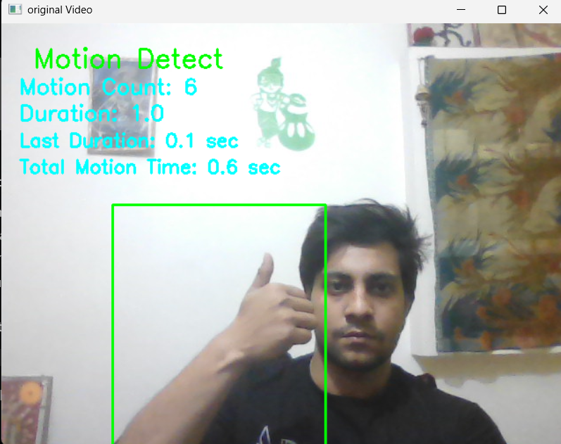

# SmartMotionDetector

A real-time motion detection system built using Python and OpenCV.

## Features

- Real-time webcam monitoring
- Motion detection using MOG2 Background Subtraction
- Contour detection and bounding boxes
- Motion event counting
- Automatic screenshot capture when motion is detected
- Timestamp-based screenshot naming
- Motion event logging
- Motion duration tracking
- Total motion time tracking

## Technologies Used

- Python
- OpenCV
- NumPy

## Project Structure

```text
SmartMotionDetector/
│
├── logs/
│   └── motion_log.txt
│
├── screenshots/
│   └── motion_*.jpg
│
├── main.py
├── requirements.txt
├── README.md
└── .gitignore
```

## Installation

1. Clone the repository:

```bash
git clone YOUR_GITHUB_REPOSITORY_URL
```

2. Navigate to the project directory:

```bash
cd SmartMotionDetector
```

3. Create and activate a virtual environment:

```bash
python -m venv venv
```

Windows PowerShell:

```powershell
.\venv\Scripts\Activate.ps1
```

4. Install dependencies:

```bash
pip install -r requirements.txt
```

## Run the Project

```bash
python main.py
```

Press **Q** to stop webcam monitoring.

## How It Works

The system captures live video from the webcam and uses OpenCV's MOG2 background subtraction algorithm to identify motion.

When motion is detected, it:
- Draws a bounding box around the detected object.
- Saves a timestamped screenshot.
- Records the event in a log file.
- Tracks motion duration and total motion time.

## Future Improvements

- Email or notification alerts
- Motion detection sensitivity controls
- Web-based monitoring dashboard
- Video recording during motion events

## Demo

### Real-Time Motion Detection



The system detects movement through a webcam, highlights the moving region with a green bounding box, and displays motion statistics in real time.

## Author

Developed as a Python and Computer
